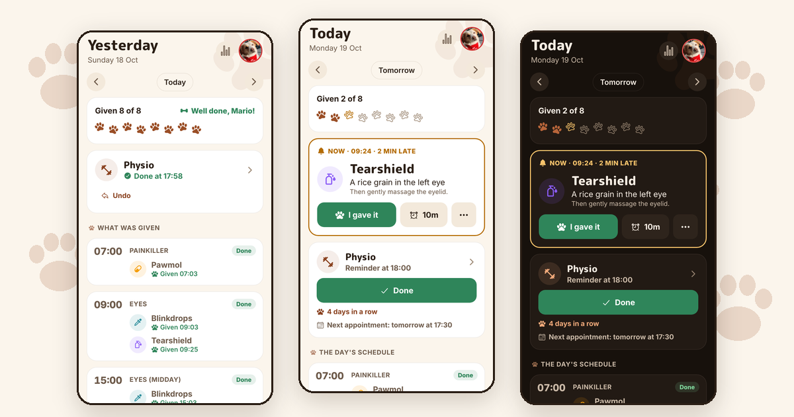
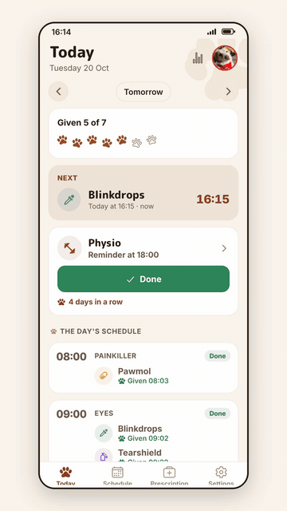
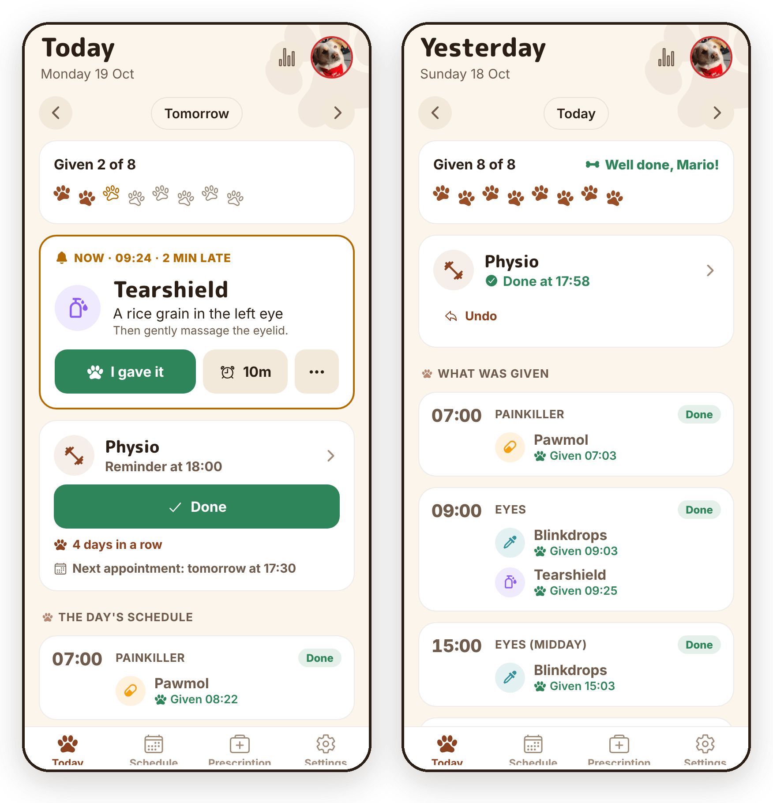
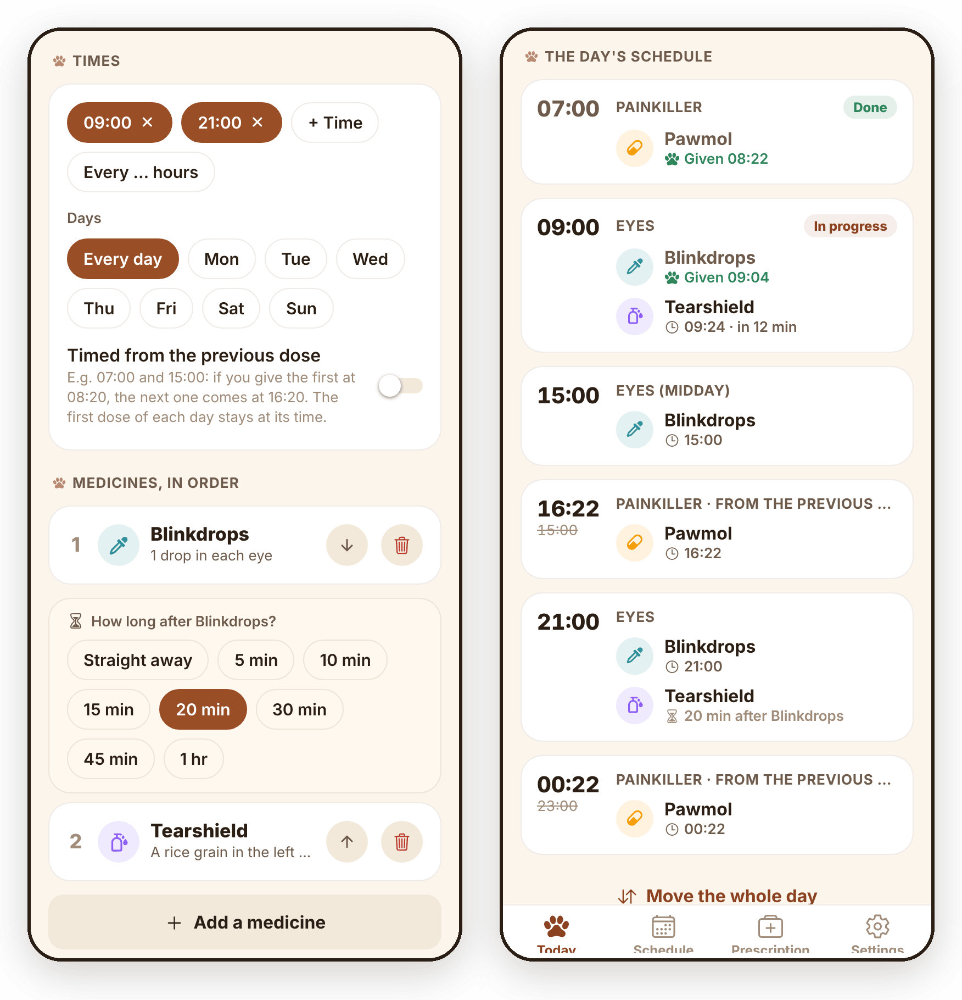
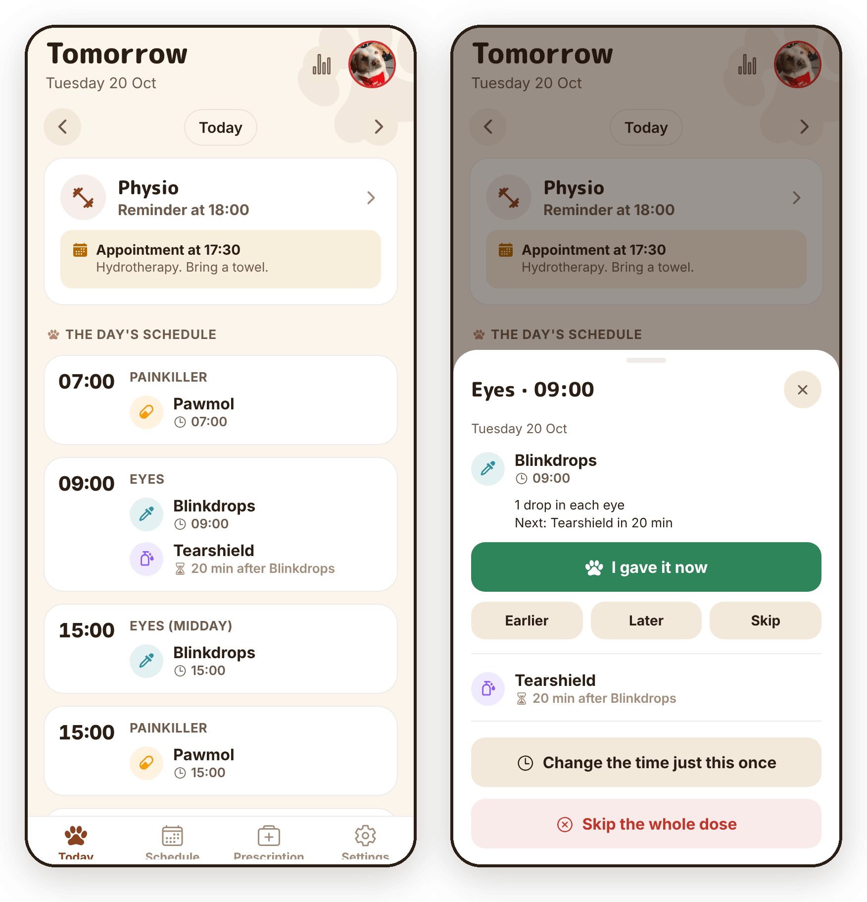
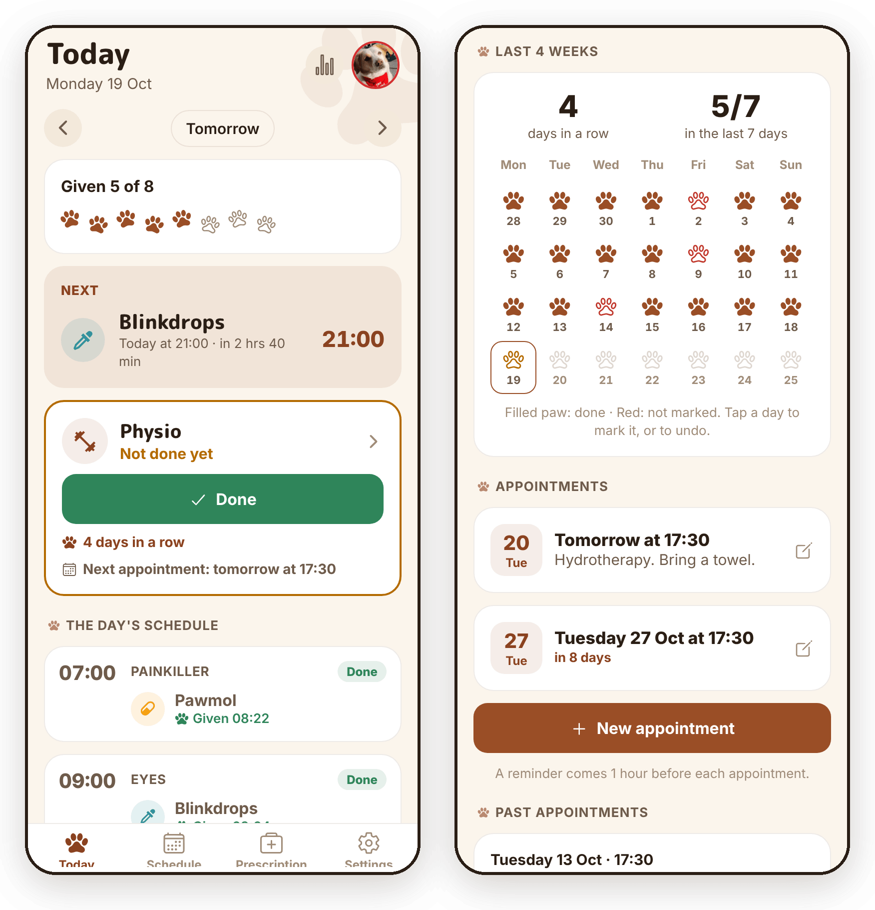
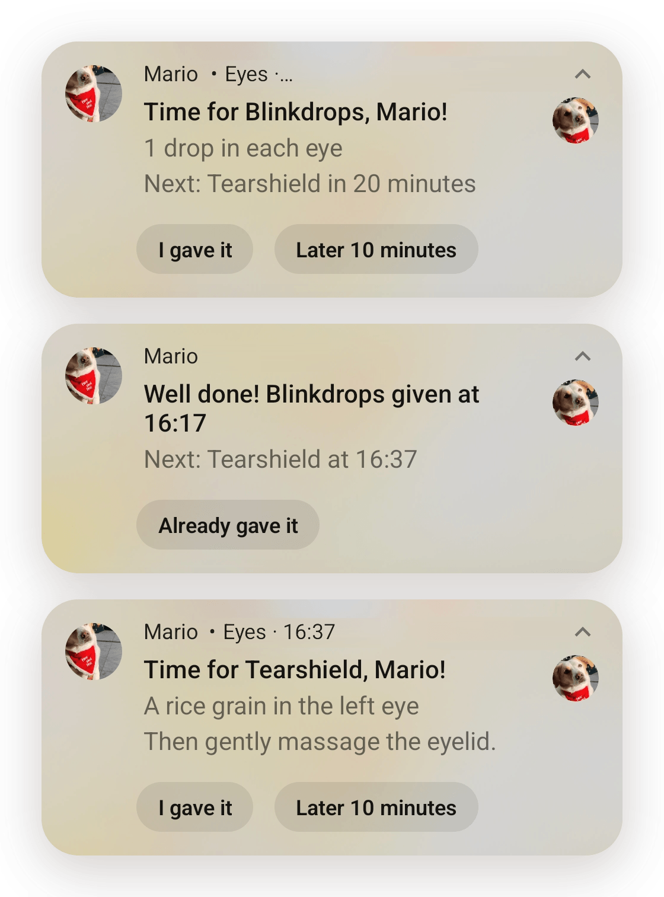

# Mario's Helper

A medicine reminder app for my dog, Mario. I built it with Expo, and I made and shipped every change from my phone.

<p align="center"></p>

<p align="center">
  <a href="docs/mario-demo.mp4"><b>Watch the 30-second video</b></a> ·
  <a href="https://marios-helper.expo.app"><b>Try it in your browser</b></a> ·
  <a href="https://github.com/altany/marios-helper/releases/latest/download/marios-helper.apk"><b>Install the Android app</b></a> ·
  <a href="https://tany4.com/blog/posts/marios-helper-v3"><b>Read how I built it</b></a>
</p>

<p align="center"></p>

## Why

Mario has eye drops several times a day, an eye ointment 20 minutes after some of them, and a painkiller every 8 hours. His medicines change often. Giving him the right medicine at the right time isn't something I can risk getting wrong, so I wanted reminders I can't miss, that follow what I actually did, and that I can change in a minute.

<p align="center"></p>

## What makes it different

- **Reminders follow the real time.** The 20 minutes start when I tap "I gave it", not at the planned time. "Every 8 hours" means 8 hours after the dose I actually gave, so a late dose moves the rest of the day with it.
- **A dose can't slip by.** A reminder stays until I answer it, rings again every 10 minutes, and comes back quietly if I swipe it away.
- **The buttons work everywhere.** "I gave it" and "Later 10 minutes" work from the notification and from my watch, with the app closed, and the next medicine is scheduled right away.
- **I can plan ahead.** Every dose of the week is planned, so I can move or skip one medicine, a whole chain or the whole day.
- **It checks the phone.** A checklist shows the settings that can stop reminders (notifications, exact alarms, battery saving) and opens the right screen to fix each one.
- **Physio too.** A daily reminder for his exercises, the last four weeks as paw prints, and his visits to the physio.
- **It looks like Mario.** His colours, paw prints that fill in as the day's doses are given, and a bark for the notification sound. In English and Greek.

<table>
  <tr>
    <td></td>
    <td></td>
  </tr>
  <tr>
    <td></td>
    <td></td>
  </tr>
</table>

<p align="center"></p>

The medicine names are made up.

## Built with Expo

- **Expo SDK 57** with React Native's New Architecture, and **expo-router** for the screens.
- **EAS Build** makes the Android app in the cloud. **EAS Update** sends JavaScript changes over the air, and the app shows "There's a new version" with a restart button.
- **One GitHub Action picks between the two**, using the app's native **fingerprint**. If a build with the same fingerprint already exists, only JavaScript changed, so it publishes an update. If not, it starts a new build and puts the install link in the run summary. The runtime version is that same fingerprint, so an update never lands on a build that can't run it. See [`deploy.sh`](scripts/deploy.sh).
- **EAS Hosting** runs the [browser demo](https://marios-helper.expo.app), with made-up data, so people without an Android phone can try it. Each pull request gets its own preview link. See [`web-demo.yml`](.github/workflows/web-demo.yml).
- **App variants**: a `test-build` label on a pull request builds "Mario TEST", a second app that installs next to the real one, with its own data. See [`app.config.js`](app.config.js).
- **Config plugins** put the bark and the notification icon into the Android app. See [`plugins/`](plugins/).
- **[react-native-notify-kit](https://github.com/marcocrupi/react-native-notify-kit)**, the maintained fork of Notifee, for notifications with buttons, exact alarms and handling taps with the app closed.
- The schedule logic is plain TypeScript with tests, apart from React and the notifications. See [`src/engine/`](src/engine/).

All of it runs on Expo's free plan.

Made for Mario: the pet's name is a setting, but the photo and the colours are his. Android only for now.

## Everything it does

- **Σήμερα (Today)** – what is due now, with big "Το έδωσα" / "Αργότερα" buttons, the next medicine, and the whole day. Go back to see what was given, or forward to see (and change) the coming days.
- **Chains of medicines** – a routine is a list of medicines given one after the other, e.g. *Blinkdrops → 20′ → Tearshield* (made-up names). The next reminder comes 20 minutes after you tap "Το έδωσα", not 20 minutes after the planned time. A quiet countdown shows how long is left.
- **Every N hours** – "Κάθε … ώρες" fills in the times from the first dose of the day (e.g. 07:00 · 15:00 · 23:00). Each later dose then counts from when the previous one was actually given: 07:00 given at 08:22 → next at 16:22, and the one after it moves along at once (00:22), then again when the second is given. The first dose of each day stays at its time. Any routine with two or more times can do this ("Μετράει από την προηγούμενη δόση").
- **Change one reminder only** – tap any future dose to move it to another time just that day, skip it, or put it back. "Αλλαγή ώρας για όλη τη μέρα" moves every dose of a day at once (e.g. when you woke up late).
- **Sticky notifications** – a reminder stays until you tap "Το έδωσα" or "Αργότερα". If it is swiped away it comes back quietly. If nobody answers it rings again every few minutes (you choose how often, up to 6 times), then stays quietly in the drawer. It only goes away by itself when the dose counts as missed (after 12 hours by default).
- **No duplicates** – each medicine of each dose has one notification id, so pressing a button twice (e.g. phone and watch) can't create extra reminders.
- **Pause** – one switch stops all reminders (e.g. while Mario stays at the vet) without changing the schedule.
- **Buttons work with the app closed** – "Το έδωσα" and "Αργότερα" on the notification (or on a smartwatch) work without opening the app, and the next medicine of the chain is scheduled right away.
- **Πρόγραμμα (Schedule)** – a preview of a normal day, the list of routines, and the next reminders.
- **Συνταγή (Prescription)** – the medicines with dose and instructions, treatment start/end dates (no reminders after the end), the vet's phone and next check-up, and free notes.
- **Ρυθμίσεις (Settings)** – pause, snooze time, repeat time, when a dose counts as missed, sticky on/off, countdown, alarm-like sound, plus a **check** of everything that can stop reminders from arriving (permissions, exact alarms, battery saving, phone-maker settings) with a button to fix each one, and a test notification.
- **Ιστορικό (History)** – the last 30 days, and how many doses were given.
- **Φυσικοθεραπεία (Physio)** – daily exercises at home: a card on Today with an "Έγινε" button, and a reminder at a set time if they aren't done yet ("Έγινε" and "Αργότερα 1 ώρα" also work from the notification and the watch). The last 4 weeks as paw prints, and how many days in a row. Visits to the physio with a note each, and a reminder an hour before. Open it from the card on Today or from Συνταγή.
- **Backup** – export all data as text and restore it later.
- **Greek and English** – the app follows the phone's language (a Greek phone gets Greek, any other gets English), and Ρυθμίσεις → Γλώσσα · Language can fix it to one. Reminders change language too. Every text is written in both languages in place, with `t('Σήμερα', 'Today')` from `src/i18n`.
- Light and dark mode. Settings from the previous version are carried over on the first start, and the old "Οδηγίες" text is kept in the prescription notes.
- Notification texts use plain words (no ✓ or ′ symbols) so they show correctly on a smartwatch.

## New versions on the phone

No laptop needed. Every change merged into `main` goes to the phone by itself (`.github/workflows/deploy.yml` → `scripts/deploy.sh`):

- **Most changes** (screens, texts, logic) arrive as an over-the-air update. The app downloads it on its own and shows "Υπάρχει νέα έκδοση" with a restart button.
- **Changes to native code** (new native library, permissions, app icon) need a new app. A new APK is built with EAS Build, and the link to install it is in the summary of the "Deploy to phone" run on GitHub. EAS deletes builds after up to 90 days, so the "APK on GitHub" workflow also puts each new APK on a [GitHub release](https://github.com/altany/marios-helper/releases/latest), where it stays (`scripts/release-apk.sh`).

### Try a change before it reaches the real app

Add the label `test-build` to a pull request. The "Test build" workflow makes a separate app, **Mario TEST** (`com.altany.marioshelper.test`), and puts its install link in the run summary. It installs next to the real app, with its own data and its own reminders, so Mario's real reminders are not touched. Each run is one EAS build.

One-time setup:

1. On expo.dev: Account settings → Access tokens → create a token.
2. On GitHub: this repo → Settings → Secrets and variables → Actions → New repository secret, name `EXPO_TOKEN`, value the token.
3. The first run makes an APK. Install it on the phone once (open the link, tap Install). From then on, updates arrive by themselves.

## How it works (for developers)

- Expo SDK 57 (React Native 0.86, New Architecture) + expo-router. Notifications use [`react-native-notify-kit`](https://github.com/marcocrupi/react-native-notify-kit), the maintained fork of [Notifee](https://github.com/invertase/notifee) (archived in April 2026), with the same API. It is imported only in `src/notify/driver.ts`.
- Instead of repeating alarms, the app works out the concrete doses ("runs") for the next 7 days from the routines (`src/engine/runs.ts`), and schedules one exact alarm per dose. Physio (`src/engine/physio.ts`) adds one alarm per day for the exercises and one per visit. Every change goes through `act()` (`src/notify/commands.ts`), which saves the data and then syncs the alarms with the plan (`src/engine/plan.ts`, `src/notify/sync.ts`). The 7 days are topped up every time the app opens or a notification fires.
- Notification buttons are handled in `src/notify/events.ts`. It is registered in `index.js` so it also runs when Android starts the app in the background.
- All data is one JSON document in AsyncStorage (`src/store/store.ts`).
- The engine is plain TypeScript with tests in `__tests__/`.

```
app/                 screens (expo-router)
src/engine/          schedule logic, no React
src/notify/          notifications (notify-kit, the Notifee fork)
src/store/           saving data
src/model/           types, default data, migration from v2
src/ui/              components, theme, sheets
assets/fonts/        rounded title font (Latin + Greek subset, OFL)
plugins/             Expo config plugins: notification icon, notification sound
assets/sounds/       the bark played by dose notifications (copied into the Android app)
```

### Install

```bash
npm install
```

### Checks

```bash
npm test            # engine tests
npm run typecheck   # TypeScript
```

### Run in development

```bash
npx expo start
```

The screens also open in a browser (`npm run web`), but notifications only work on a phone.

### Build the APK on a laptop (not needed normally)

The deploy workflow above builds it in the cloud. To build locally instead, generate the `android/` folder (this version removes the old native files):

```bash
npx expo prebuild --clean -p android
cd android && ./gradlew assembleRelease
```

Output: `android/app/build/outputs/apk/release/app-release.apk`

If you had changed anything by hand in `android/` (e.g. your own signing key in `android/app/build.gradle`), copy it somewhere first, because `--clean` deletes the folder. An APK signed with a different key can't be installed over the old app without uninstalling it (which also deletes its data).

After installing, open the app once and look at **Ρυθμίσεις → Έλεγχος**. On Samsung / OnePlus / Xiaomi phones, allow the app to run in the background without battery limits.
